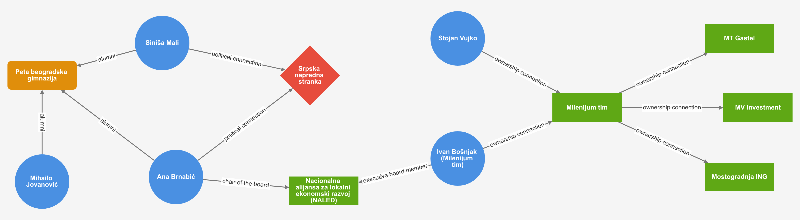

# Veze i Poznanstva

**Prati novac. Da bi znao gde, isprati konekcije.**

*English version: [README.md](README.md)*

**Doprinesi našoj bazi uz pomoć AI.** Počni od
[prompta za brzi početak](docs/agent-prompt.sr.md): nalepi ga svom agentu za programiranje, ili
četbotu u pregledaču koji će ti prvo pomoći da instaliraš desktop verziju. On podešava alate,
forkuje repozitorijum i vodi te, na srpskom, kroz dodavanje veza sa izvorima.

**[Otvori graf](https://veze-i-poznanstva.github.io/vip/?lang=sr)** ·
**[Informacija nije tačna?](https://veze-i-poznanstva.github.io/vip/?lang=sr&ispravka=1)**

VIP (Veze i poznanstva) je otvorena, mašinski proverljiva mapa o tome ko je s kim povezan među
uticajnim ljudima u Srbiji, i preko čega.



*Deo grafa. Svaka linija je dokumentovana veza, a ne optužba.*

## Problem

Korupciji je potrebno poverenje. Ko krši pravila traži saradnike koji ga neće odati, a nalazi ih
među onima koji su već vezani za njega lojalnošću: među rođacima, prijateljima, stranačkim
kolegama. U Srbiji kum, rođak ili školski drug mogu biti deo takvog kruga. Rezultat su poslovi dati
svojima, javne nabavke koje dobija prava firma i provizije.

Te veze se retko vide na jednom mestu, a novac retko ostavlja čist trag. Ali ko sedi u kom odboru,
ko šta poseduje i ko je kome rod često je javno, rasuto po registrima i arhivama medija. VIP
sastavlja te činjenice.

## Šta VIP jeste, a šta nije

Veza je trag, a ne dokaz. Ona ukazuje na moguće favorizovanje, nepotizam ili dosluh i alat je za
istraživačko novinarstvo. Ponekad je direktan problem, kao kada posao dobije supruga funkcionera.
Češće osvetljava svet odnosa koji je toliko važan u ljudskom društvu. Biti rođak ili ići u istu
školu nije prestup.

VIP sabira ono što objavljuju ugledni mediji i zvanični registri. On ih ne proverava i nije pravni
dokaz; njegov zadatak je da ih tačno prenese i pokaže odakle potiče svaka tvrdnja. Svaki entitet i
svaka veza navode najmanje dva javna dokumenta sa dva različita domena, dostupna uživo ili kroz
arhiviranu kopiju, a build to automatski proverava.

Projekat je inspirisan [Poderopedijom](https://www.poderopedia.org/). Više u dokumentu
[Zašto mapirati veze](docs/why-connections.sr.md).

## Dokumentacija

| Dokument | Šta pokriva |
|---|---|
| [Zašto mapirati veze](docs/why-connections.sr.md) | Problem detaljno, nalazi istraživanja i granice |
| [Vodič za podatke](docs/data-guide.sr.md) | Kako se beleže činjenice, rečnik, kako doprineti podacima |
| [Alati](docs/tools.sr.md) | Validatori, pravila za crvene zastavice, pregledač, jezici i build |
| [Prompt za brzi početak](docs/agent-prompt.sr.md) | Doprinos uz pomoć AI agenta |
| [Dizajn istraživača grafa](docs/ui-design.sr.md) | Kuda ide pregledač |

## Pogledajte graf

Potrebna je samo Java 17 ili novija; build preuzima sve ostalo.

```bash
./gradlew :app:ttlToCytoscape   # osvežava podatke aplikacije iz data/
./gradlew :web:npmDev           # pokreće aplikaciju; zaustavlja se sa Ctrl+C
./gradlew verify                # pokreće sve provere
```

Otvorite <http://localhost:5173/?lang=sr>, ili <http://localhost:5173/> za engleski. Ukucajte ime u
polje za pretragu, kliknite na čvor da ga stavite u središte, dvostrukim klikom dodajte njegove
veze, a zadržite pokazivač na čvoru da pročitate njegov opis. Dugme Poveži pored polja za pretragu
traži Od i Do, kao uputstva na mapi, i prikazuje najkraće putanje između njih.
Filter na dnu skriva osobe, organizacije, ustanove ili stranke.

## Licenca

SPDX-License-Identifier: LicenseRef-DACL-0.1

Kod, primer podataka i dokumentacija napisani za ovaj projekat objavljeni su pod licencom
[Degrowth-Aligned Commons License (DACL) 0.1](LICENSE.md) ili bilo kojom kasnijom verzijom koju
objave njeni staratelji na [codeberg.org/degrowth-boundary-commons/dacl](https://codeberg.org/degrowth-boundary-commons/dacl).
DACL je licenca dostupnog izvornog koda sa obavezom deljenja pod istim uslovima i sa
ograničenjima namene. Nije licenca koju je odobrio OSI. Pročitajte licencu pre ponovne upotrebe.

Obim: `schema.ttl` je revizija rečnika PoderVocab koji je napravila Poderopedija. To nije delo
ovog projekta i ovde se ne licencira iznova; ostaje pod uslovima koje su izabrali njegovi
autori. Sopstvene dopune šeme, pojmove `vip:`, SHACL oblike i srpske oznake, ovaj projekat nudi
pod DACL licencom.
