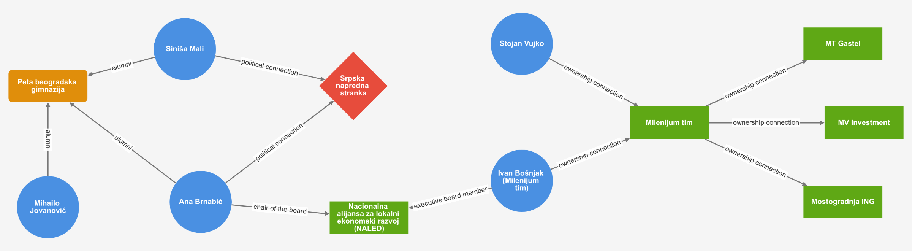

# Veze i Poznanstva

**Follow the money. To know where, follow the connections.**

*Srpska verzija: [PROCITAJME.md](PROCITAJME.md)*

**Contribute to our database with the help of AI.** Start with the
[agent quickstart prompt](docs/agent-prompt.md): paste it to your coding agent, or to a browser chat
that will first help you install a desktop version. It sets up the tools, forks the repository and
guides you, in Serbian, through adding sourced connections.

VIP (Veze i poznanstva, connections and acquaintances) is an open, machine-checkable map of who is
connected to whom among people of influence in Serbia, and through what.



*A section of the graph. Each line is a documented connection, not an accusation.*

## The problem

Corruption needs trust. People who break the rules look for collaborators who will not tell on
them, and they find them among those already bound to them by loyalty: relatives, friends, party
colleagues. In Serbia a kum, a cousin or a school friend can all belong to such a circle. The
result is jobs given to connections, public tenders won by the right company, and kickbacks.

These connections rarely appear in one place, and the money rarely leaves a clean trail. But who
sits on which board, who owns what and who is related to whom is often public, scattered across
registries and news archives. VIP puts those facts together.

## What VIP is and is not

A connection is a lead, not proof. It is an indicator of possible favoritism, nepotism or collusion,
and a tool for investigative journalism. Sometimes it is a direct problem, as when a job goes to an
official's wife. More often it sheds light on the world of relationships that matters so much in
human society. Being related, or having gone to the same school, is not wrongdoing.

VIP aggregates what reputable media and official registries report. It does not fact-check them and
it is not legal proof; its job is to report them correctly and show where each claim comes from.
Every entity and connection cites at least two public documents from two different domains, each
reachable live or through an archived copy, and the build checks this automatically.

The project is inspired by [Poderopedia](https://www.poderopedia.org/). More in
[Why map connections](docs/why-connections.md).

## Documentation

| Document | What it covers |
|---|---|
| [Why map connections](docs/why-connections.md) | The problem in depth, evidence from research, and the limits |
| [Data guide](docs/data-guide.md) | How facts are recorded, the vocabulary, how to contribute data |
| [Tools](docs/tools.md) | Validators, red-flag rules, the viewer, languages and the build |
| [Agent quickstart prompt](docs/agent-prompt.md) | Contributing with an AI agent |
| [Graph explorer design](docs/ui-design.md) | Where the viewer is going |

## See the graph

Java 17 or newer is the only requirement; the build downloads the rest.

```bash
./gradlew :app:ttlToCytoscape   # refresh the viewer's data from data/
./gradlew :web:npmDev           # start the viewer; stop it with Ctrl+C
./gradlew verify                # run every check
```

Open <http://localhost:5173/>, or <http://localhost:5173/?lang=sr> for Serbian. Type a name into the
search box, click a node to make it the centre, double-click to add its connections, and rest the
pointer on a node to read its description.

## License

SPDX-License-Identifier: LicenseRef-DACL-0.1

The code, the example data and the documentation written for this project are released under
the [Degrowth-Aligned Commons License (DACL) 0.1](LICENSE.md) or any later version published
by its stewards at [codeberg.org/degrowth-boundary-commons/dacl](https://codeberg.org/degrowth-boundary-commons/dacl).
DACL is a source-available, share-alike commons license with purpose restrictions. It is not an OSI-approved open source license. Read the license before reusing
the work.

Scope: `schema.ttl` is a revision of PoderVocab, the vocabulary created by Poderopedia. It is
not this project's work and is not relicensed here; it remains under whatever terms its
authors chose. The project's own additions to the schema, the `vip:` terms, the SHACL shapes and
the Serbian labels, are offered under DACL.
